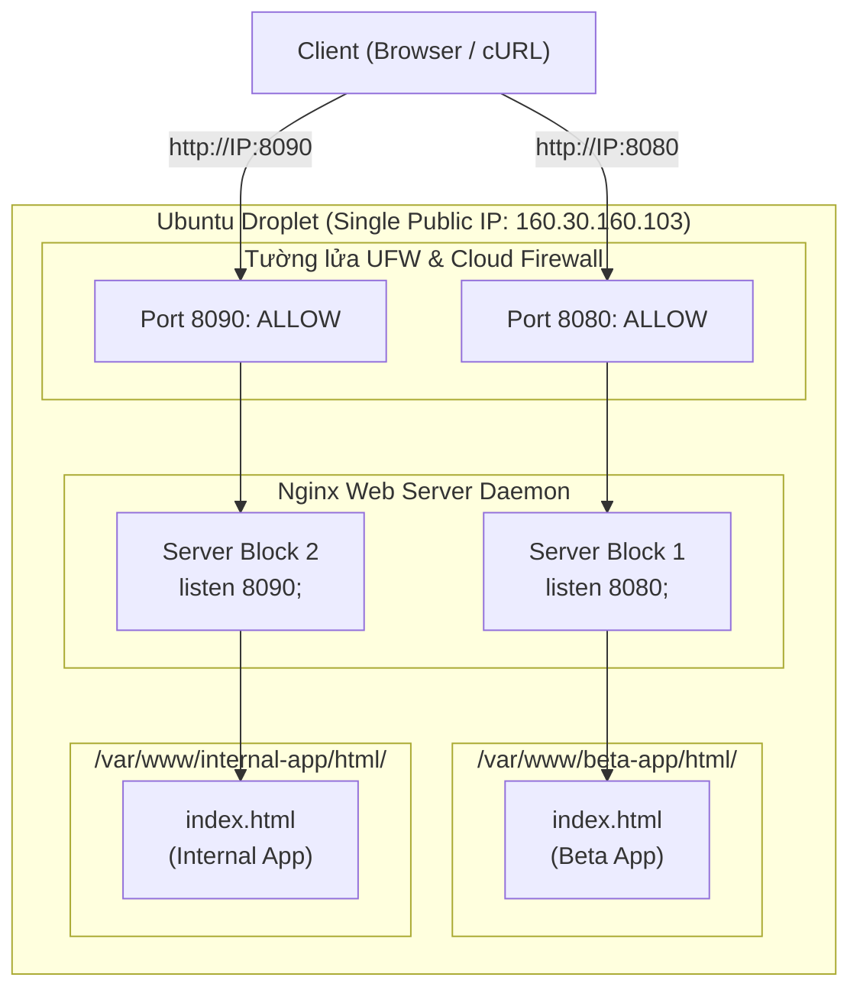

# BÀI TẬP 4: CHẠY SONG SONG NHIỀU CỔNG DỊCH VỤ (NGINX VIRTUAL HOSTS / MULTI-PORT)

**Mã bài tập:** SESSION 03 - EXERCISE 4 (ss03-ex4)  
**Môn học:** IT215 - Cloud Infrastructure & DevOps Fundamentals  
**Web Server:** Nginx trên Ubuntu Server 24.04 LTS  
**Mục tiêu:** Chạy song song 2 ứng dụng web độc lập trên cùng 1 máy chủ thông qua 2 cổng khác nhau: `8080` và `8090`  

---

## 1. MỤC TIÊU BÀI TẬP

1. **Tối ưu hóa Tài nguyên Máy chủ (Multi-tenancy on Single Server):** Tận dụng tối đa tài nguyên của 1 máy ảo Droplet để phục vụ nhiều ứng dụng khác nhau mà không cần dựng thêm server mới.
2. **Kỹ thuật Phân chia Cổng (Port-based Virtual Hosting):** Cấu hình các khối `server { ... }` riêng biệt trong Nginx để định tuyến các yêu cầu HTTP dựa trên cổng lắng nghe (`listen 8080;` và `listen 8090;`).
3. **Cấu hình Tường lửa Đa tầng (Multi-layer Firewall Configuration):** Mở các cổng tương ứng trên tường lửa hệ điều hành (UFW) và Cloud Firewall của DigitalOcean để cho phép người dùng từ Internet truy cập thông suốt.

---

## 2. BẢNG TỔNG HỢP THÔNG SỐ CẤU HÌNH

| Tiêu chí | Ứng dụng 1: Beta App | Ứng dụng 2: Internal App |
| :--- | :--- | :--- |
| **Mục đích sử dụng** | Môi trường thử nghiệm tính năng mới | Cổng thông tin & tài liệu nội bộ |
| **Cổng dịch vụ (Port)** | **`8080`** (TCP) | **`8090`** (TCP) |
| **Thư mục Web Root** | `/var/www/beta-app/html/` | `/var/www/internal-app/html/` |
| **Tập tin giao diện** | `index.html` (Beta App Title) | `index.html` (Internal App Title) |
| **Luật Tường lửa UFW** | `sudo ufw allow 8080/tcp` | `sudo ufw allow 8090/tcp` |
| **Luật Cloud Firewall** | Inbound TCP `8080` (Anywhere) | Inbound TCP `8090` (Anywhere) |

---

## 3. MÔ HÌNH ĐỊNH TUYẾN DỰA TRÊN CỔNG (PORT-BASED VIRTUAL HOST)



---

## 4. CHI TIẾT CÁC BƯỚC THỰC HIỆN TRÊN MÁY CHỦ

### Bước 1: Khởi tạo thư mục và nội dung cho 2 ứng dụng

Tạo cấu trúc thư mục web root:
```bash
sudo mkdir -p /var/www/beta-app/html
sudo mkdir -p /var/www/internal-app/html
```

Tạo file `index.html` cho **Beta App** (`/var/www/beta-app/html/index.html`):
```bash
sudo nano /var/www/beta-app/html/index.html
```
*Nội dung:*
```html
<!DOCTYPE html>
<html>
<head><title>Beta App Environment</title></head>
<body>
    <h1>Beta App Environment - Port 8080</h1>
    <p>Môi trường thử nghiệm ứng dụng Beta.</p>
</body>
</html>
```

Tạo file `index.html` cho **Internal App** (`/var/www/internal-app/html/index.html`):
```bash
sudo nano /var/www/internal-app/html/index.html
```
*Nội dung:*
```html
<!DOCTYPE html>
<html>
<head><title>Internal App Environment</title></head>
<body>
    <h1>Internal App Environment - Port 8090</h1>
    <p>Môi trường thông tin nội bộ.</p>
</body>
</html>
```

Phân quyền sở hữu thư mục web:
```bash
sudo chown -R www-data:www-data /var/www/beta-app /var/www/internal-app
sudo chmod -R 755 /var/www/beta-app /var/www/internal-app
```

---

### Bước 2: Cấu hình Server Block trong Nginx

Tạo file cấu hình gộp `/etc/nginx/sites-available/multi-port.conf`:
```bash
sudo nano /etc/nginx/sites-available/multi-port.conf
```

Thêm nội dung cấu hình 2 khối server:
```nginx
# Server Block 1: Beta App trên cổng 8080
server {
    listen 8080;
    listen [::]:8080;

    server_name _;

    root /var/www/beta-app/html;
    index index.html index.htm;

    location / {
        try_files $uri $uri/ =404;
    }
}

# Server Block 2: Internal App trên cổng 8090
server {
    listen 8090;
    listen [::]:8090;

    server_name _;

    root /var/www/internal-app/html;
    index index.html index.htm;

    location / {
        try_files $uri $uri/ =404;
    }
}
```

Kích hoạt file cấu hình:
```bash
sudo ln -sf /etc/nginx/sites-available/multi-port.conf /etc/nginx/sites-enabled/
```

Kiểm tra cú pháp và tải lại Nginx:
```bash
sudo nginx -t
sudo systemctl reload nginx
```

---

### Bước 3: Mở cổng trên Tường lửa UFW & Cloud Firewall

**1. Mở trên UFW (Hệ điều hành máy chủ):**
```bash
sudo ufw allow 8080/tcp
sudo ufw allow 8090/tcp
sudo ufw status verbose
```

**2. Mở trên DigitalOcean Cloud Firewall (Nếu có kích hoạt):**
- Đăng nhập vào trang quản trị DigitalOcean.
- Vào mục **Networking > Firewalls > Chọn Firewall của bạn**.
- Tại mục **Inbound Rules**, thêm 2 quy tắc:
  - `Custom` | `TCP` | `8080` | `All IPv4`, `All IPv6`
  - `Custom` | `TCP` | `8090` | `All IPv4`, `All IPv6`
- Nhấn **Save Rule**.

---

## 5. KIỂM TRA VÀ KẾT QUẢ XÁC MINH

### Kiểm tra cổng 8080 (Beta App):
```bash
curl http://<IP_ADDRESS_DROPLET>:8080
```
* **Kết quả:** Trả về mã HTML của Beta App (tiêu đề *"Beta App Environment - Port 8080"*).

### Kiểm tra cổng 8090 (Internal App):
```bash
curl http://<IP_ADDRESS_DROPLET>:8090
```
* **Kết quả:** Trả về mã HTML của Internal App (tiêu đề *"Internal App Environment - Port 8090"*).

---

## 6. HÌNH ẢNH MINH CHỨNG & LOG TERMINAL

### Hình ảnh minh chứng


---

### Trích xuất Log Terminal thực tế

```text
devops@0310263186:~$ sudo ufw allow 8080/tcp
Rule added
Rule added (v6)

devops@0310263186:~$ sudo ufw allow 8090/tcp
Rule added
Rule added (v6)

devops@0310263186:~$ sudo nginx -t
nginx: the configuration file /etc/nginx/nginx.conf syntax is ok
nginx: configuration file /etc/nginx/nginx.conf test is successful

devops@0310263186:~$ sudo systemctl reload nginx

devops@0310263186:~$ sudo ss -tulpn | grep -E '8080|8090'
tcp   LISTEN 0      511          0.0.0.0:8080      0.0.0.0:*    users:(("nginx",pid=2345,fd=6))
tcp   LISTEN 0      511          0.0.0.0:8090      0.0.0.0:*    users:(("nginx",pid=2345,fd=7))

devops@0310263186:~$ curl http://localhost:8080
<!DOCTYPE html>
<html>
<head><title>Beta App Environment</title></head>
<body>
    <h1>Beta App Environment - Port 8080</h1>
    <p>Môi trường thử nghiệm ứng dụng Beta.</p>
</body>
</html>

devops@0310263186:~$ curl http://localhost:8090
<!DOCTYPE html>
<html>
<head><title>Internal App Environment</title></head>
<body>
    <h1>Internal App Environment - Port 8090</h1>
    <p>Môi trường thông tin nội bộ.</p>
</body>
</html>
```
